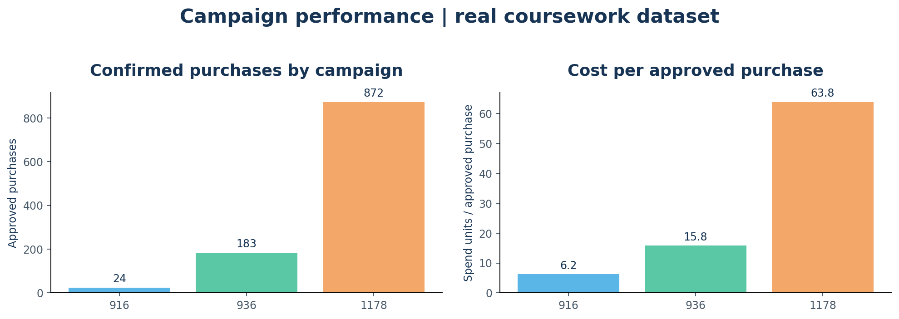
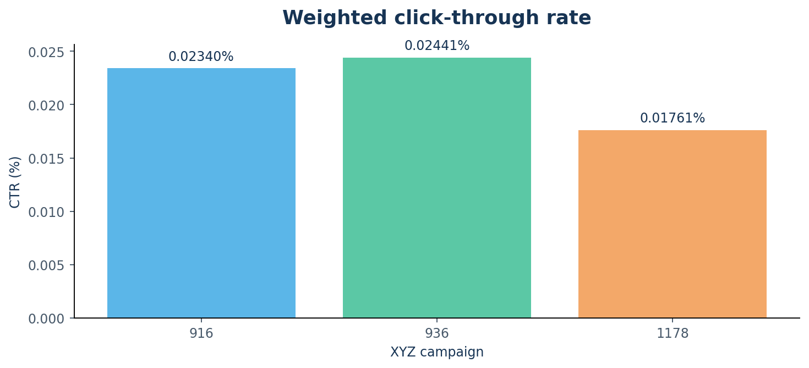
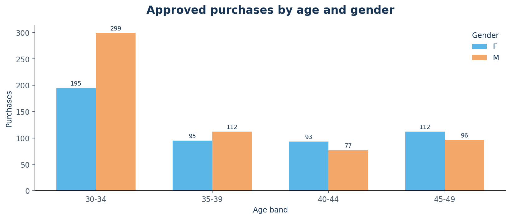
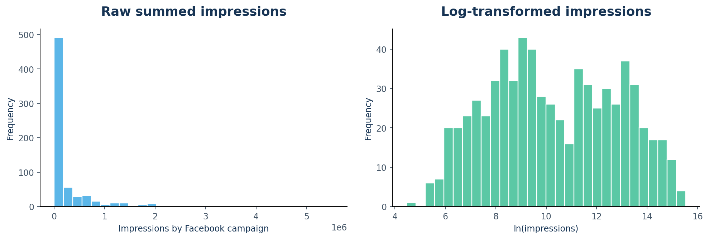
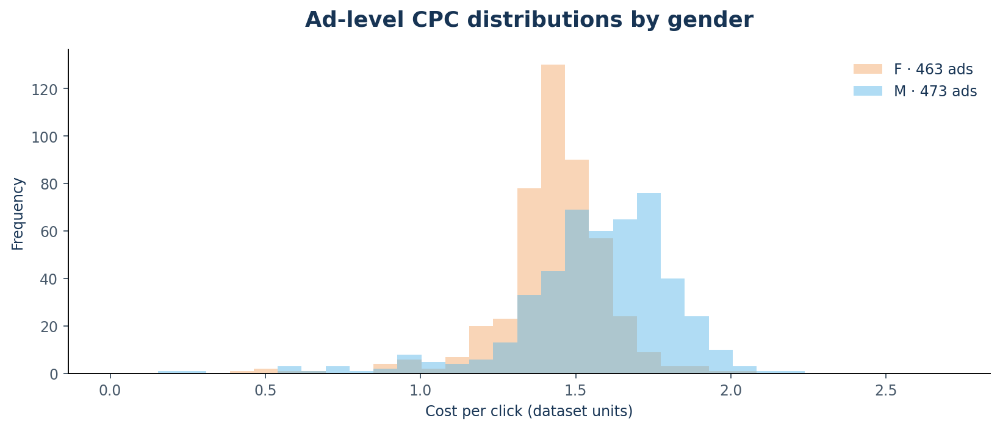

# 📊 Digital Advertising Campaign Analytics

**End-to-end marketing analytics portfolio project:** exploratory data analysis, an interactive Streamlit app, weighted KPI calculations, campaign benchmarking, audience targeting, and data-quality auditing.

**Stack:** Python · Pandas · NumPy · Seaborn · Matplotlib · Plotly · Streamlit · SQL · Pytest · GitHub Actions

> **Dataset:** 1,143 ad-level observations across three XYZ campaigns (IDs 916, 936 and 1178). Based on a user-supplied Karpov.Courses educational dataset. **Currency, customer-level attribution and event dates are not supplied.** This is descriptive analytics, not an A/B experiment.



## Business question

Which campaigns and audience segments generated approved purchases most efficiently, and how reliable are the advertising metrics in the underlying data?

## Headline results · original dataset

| KPI | Result |
|---|---:|
| Advertisements | **1,143** |
| XYZ campaigns | **3** |
| Impressions | **213,434,828** |
| Clicks | **38,165** |
| Approved purchases | **1,079** |
| Total ad spend | **58,705.23** dataset units |
| Weighted CTR | **0.01788%** |
| Weighted CPC | **1.538** dataset units |
| Clicks to approved purchases (aggregate) | **2.83%** |
| Cost per approved purchase | **54.41** dataset units |

### Three campaigns compared

| Campaign ID | Ads | Approved purchases | Weighted CTR | Cost / approved purchase |
|---|---:|---:|---:|---:|
| 916 | 54 | 24 | 0.02340% | 6.24 |
| 936 | 464 | 183 | 0.02441% | 15.81 |
| 1178 | 625 | 872 | 0.01761% | 63.83 |

**Key insight:** campaign **1178** produced the most purchases, but campaign **916** has the lowest observed spend per approved purchase. Because their sizes differ greatly, these figures are descriptive, not proof of optimal budget allocation.

**Critical data-quality finding:** 72 source rows show **approved purchases > clicks**, including 71 ads with a purchase despite zero clicks. We do not hide or force-correct these events. The purchases-to-clicks ratio is shown as an **aggregated descriptive ratio**, not a guaranteed user-level conversion probability.

### Other figures

| Campaign weighted CTR | Age / gender segments |
|---|---|
|  |  |

| Impressions: raw versus log | Cost per click by gender |
|---|---|
|  |  |

More details: **[executive report](reports/insights.md)**, **[SQL outputs](reports/sql_results.md)**.

## Interactive dashboard

Run the app locally with the source CSV to analyze real data. **On a public hosting service**, the app defaults to **explicitly labelled synthetic demo data** unless a user uploads a CSV. The original dataset is excluded from Git commits until its redistribution rights are confirmed.

The six interactive tabs are:

1. **Overview** — high-level KPIs, campaign volumes and conversions.
2. **Campaigns** — weighted CTR, CPC, cost per purchase, and share of total spend versus purchases.
3. **Audience** — age, gender and interest segments with minimum-click thresholds.
4. **Ad explorer** — spend-to-purchases scatter plot, sortable table and CSV export.
5. **Data quality** — structural anomalies and undefined ratios.
6. **Methodology** — metric definitions and interpretation limits.

### Quick start (Windows / macOS / Linux)

```bash
# 1. Install dependencies
python -m pip install -r requirements.txt

# 2. Put the coursework file at data/raw/conversion.csv
#    (already present in the downloadable local project ZIP)

# 3. Launch the interactive dashboard
streamlit run app.py

# 4. Run the reproducible analysis and tests
python scripts/generate_report.py
python scripts/run_sql.py
python -m pytest -q
```

**Jupyter Notebook:** [`notebooks/01_marketing_eda.ipynb`](notebooks/01_marketing_eda.ipynb) (executed with the original dataset). For best results, open the repository root in VS Code / Jupyter.

## Files

```text
digital-advertising-campaign-analytics/
├── app.py                           # Streamlit dashboard
├── README.md                        # Portfolio story
├── START_HERE_RU.md                 # Setup guide in Russian
├── requirements.txt                 # Python dependencies
├── .streamlit/config.toml           # App theme
├── .github/workflows/tests.yml      # Automated tests
├── data/
│   ├── raw/conversion.csv           # Local only; excluded from public Git
│   ├── demo/synthetic_ads.csv       # Clearly labelled demo
│   └── README.md                    # Data policy / schema
├── notebooks/01_marketing_eda.ipynb
├── src/analysis.py                  # Reusable calculations
├── scripts/
│   ├── create_notebook.py
│   ├── generate_report.py
│   └── run_sql.py
├── sql/queries.sql
├── reports/
│   ├── insights.md
│   ├── sql_results.md
│   ├── campaign_summary.csv
│   ├── audience_segments.csv
│   └── figures/*.png
├── docs/METRICS_AND_LIMITATIONS.md
└── tests/test_analysis.py
```

## Metric definitions

All rates in campaign / segment reports are calculated as **ratio of sums** rather than the arithmetic mean of individual ad ratios.

- **CTR:** clicks ÷ impressions.
- **CPC:** spend ÷ clicks.
- **Click-to-purchase ratio:** approved purchases ÷ clicks (descriptive aggregate, because the data do not form a strictly nested funnel).
- **Cost per approved purchase (CPA proxy):** spend ÷ approved purchases.
- **CPC IQR:** 75th − 25th percentile of defined ad-level CPC values (≈0.2544 on the original dataset).
- **Undefined denominator:** `NaN`, never silently replaced by zero.

**No inferred revenue, profit, ROAS, ROI, causal lift, or calendar trends.** The dataset does not provide the information required for these analyses. See [metrics and limitations](docs/METRICS_AND_LIMITATIONS.md).

## Data and license

This project uses a dataset supplied for coursework. **Raw `conversion.csv` is included in the downloadable local archive, but `.gitignore` excludes it from version control by default**. Before publishing the CSV itself, confirm that its license permits redistribution. Browser upload tools can bypass `.gitignore`; exclude the raw CSV manually when dragging files into GitHub.

The MIT license applies only to the **original code written for this repository**, not to the dataset or third-party material.

## Tests

8 unit tests verify weighted aggregation, safe zero-denominator handling, schema checks, no mutation of source data, and anomaly detection. GitHub Actions runs these checks without requiring the coursework dataset.
