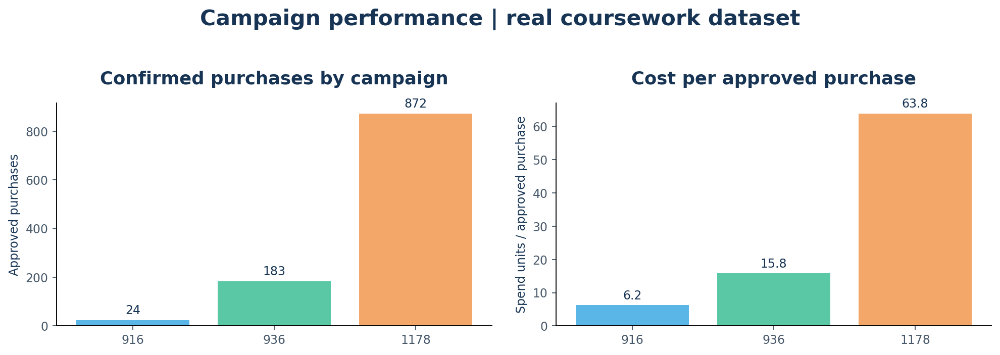
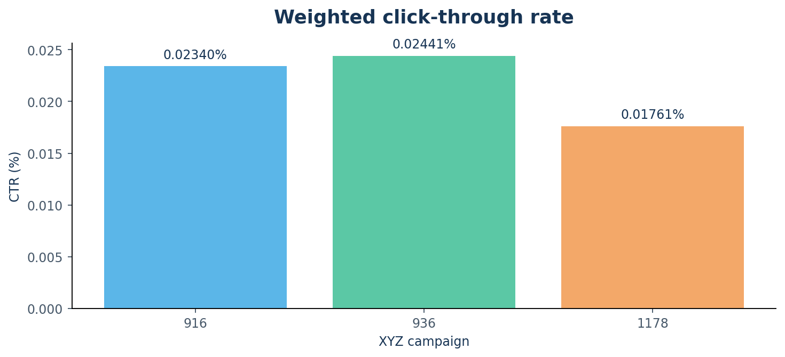
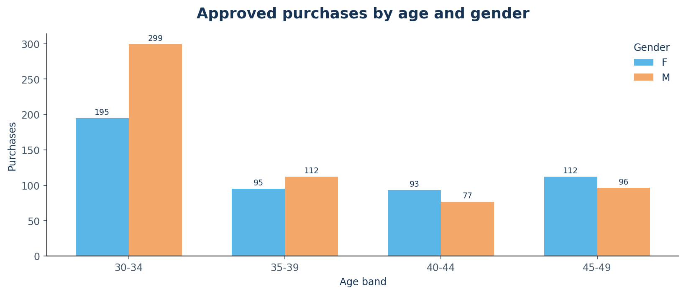
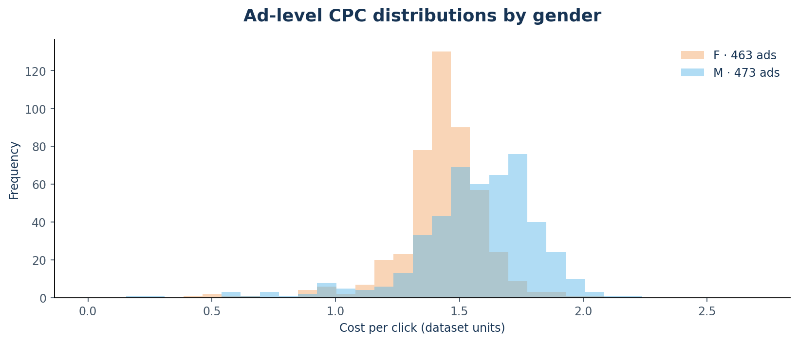
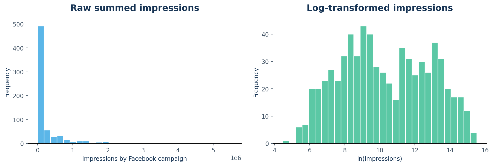
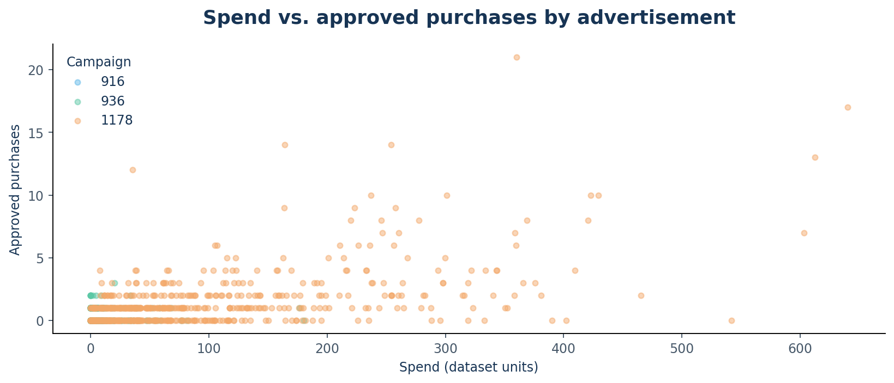

# Digital Advertising Campaign Analytics — Executive Insights

**Source:** user-supplied `conversion.csv` from a coursework exercise.  
**Scope:** 1,143 advertisement-level records, 3 XYZ campaigns, no time dimension.  
**Data currency:** unspecified; costs are displayed in *dataset monetary units*.

## Verified headline KPIs

| Metric | Result | Definition |
|---|---:|---|
| Ads | 1,143 | source rows |
| Impressions | 213,434,828 | summed exposure events |
| Clicks | 38,165 | summed clicks |
| Click-through rate | 0.01788% | total clicks ÷ total impressions |
| Total ad spend | 58,705.23 | dataset monetary units |
| Cost per click | 1.538 | total spend ÷ clicks |
| Interested actions | 3,264 | `Total_Conversion` sum |
| Approved purchases | 1,079 | `Approved_Conversion` sum |
| Approved purchases / clicks | 2.83% | descriptive aggregate ratio |
| Cost per approved purchase | 54.41 | spend ÷ approved purchases |
| CPC IQR (per-ad, non-null) | 0.2544 | Q3 − Q1 |

## Campaign comparisons

| XYZ campaign | Ads | Clicks | Purchases | CTR | CPC | Cost / purchase |
|---:|---:|---:|---:|---:|---:|---:|
| 916 | 54 | 113 | 24 | 0.02340% | 1.32 | 6.24 |
| 936 | 464 | 1,984 | 183 | 0.02441% | 1.46 | 15.81 |
| 1178 | 625 | 36,068 | 872 | 0.01761% | 1.54 | 63.83 |

The highest **absolute count of approved purchases** is in campaign **1178** (872 approved purchases). Campaign **916** has the lowest **observed cost per approved purchase** (6.24 dataset units). These are descriptive comparisons, not causal estimates or proof of profitability. Campaign sizes differ greatly.





## Audience / ad distribution









## Data-quality audit

| Check | Value |
|---|---:|
| Rows | 1,143 |
| Duplicates | 0 |
| Missing cells | 0 |
| Zero click ads | 207 |
| Purchases gt clicks | 72 |
| Purchases with zero clicks | 71 |
| Interests gt clicks | 218 |
| Negative metrics | 0 |

**Important:** source rows can contain approved conversions with zero clicks, and conversions greater than clicks. These cases can reflect attribution/modeling quirks, definitions that differ from a strict user funnel, or source errors. We **retain and flag** them, and call clicks-to-purchases a *descriptive ratio*, not a validated individual-user conversion probability. Do not infer causality.

## Business-oriented next steps (hypotheses, not proven outcomes)

1. Investigate the data-generation and attribution logic behind click/conversion inconsistencies before making channel-allocation decisions.
2. Compare weighted campaign cost per purchase, not average ad-level CPC, and check sample sizes for low-volume cohorts.
3. Explore interests and gender/age strata with a minimum-click threshold; avoid ranking tiny groups based on noisy ratios.
4. Obtain purchase revenue, timestamps, ad objectives, and attribution windows for ROAS, time trends, controlled testing, or optimization recommendations.

## Reproduction

```bash
pip install -r requirements.txt
python scripts/generate_report.py
python -m pytest -q
streamlit run app.py
```

Report generated from original local file, not from synthetic demo data.
